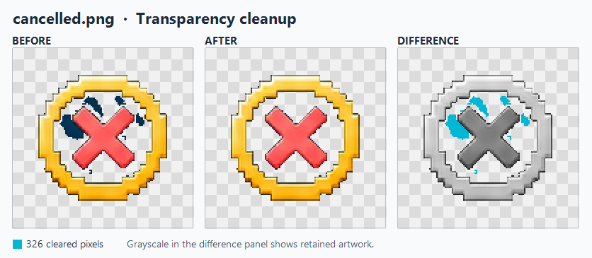
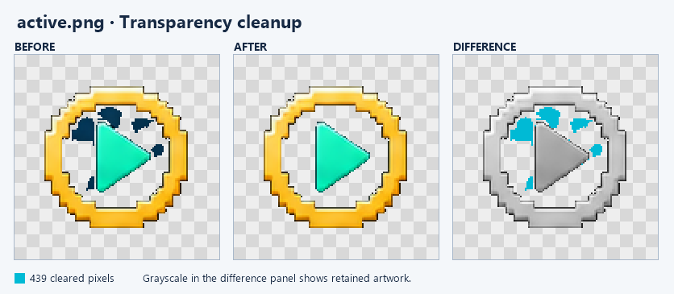

# PixelAlfa Codex Skill

[](https://github.com/fezcat/pixelalfa-codex-skill/actions/workflows/verify-examples.yml)

Review pixel-art PNGs for stray background pixels, transparency issues, and outline damage. The `$pixelalfa` skill guides Codex through inspecting the source, proposing a small edit, and checking the result pixel by pixel with local PNG tools.

This project is licensed under the [MIT License](LICENSE).

## Quick start

Clone the repository, open the cloned folder in Codex, and invoke `$pixelalfa`.

```sh
git clone https://github.com/fezcat/pixelalfa-codex-skill.git
cd pixelalfa-codex-skill
```

To use the skill in an existing project, copy `.agents/skills/pixelalfa/` into that project's `.agents/skills/` directory. Keep `references/editor.md` inside the skill folder. To install it for personal use, ask Codex to run `$skill-installer` with the repository `fezcat/pixelalfa-codex-skill` and the path `.agents/skills/pixelalfa`. [Codex skill discovery and installation](https://learn.chatgpt.com/docs/build-skills#where-codex-loads-local-skills)

## Example prompts

**Review a sprite before editing**

> $pixelalfa Inspect sprite.png at native pixel coordinates. Separate likely background residue from uncertain outline pixels. Report each group's size and representative coordinates.

**Remove confirmed residue**

> $pixelalfa Remove the confirmed background residue from sprite.png. Keep the dark outline and translucent edge pixels. Save the result as sprite-cleaned.png and report what changed.

**Verify an export against a mask**

> $pixelalfa Compare sprite.png and sprite-cleaned.png using allowed-edits.png. Check the dimensions and report any RGBA differences outside the mask.

**Repair a broken outline**

> $pixelalfa Inspect the gap in the outer outline of sprite.png near (45, 52). Preview a repair that follows the existing contour and preserves nearby shading.

## How the workflow works

1. Open the PNG at its original resolution and identify details to preserve.
2. Group plausible residue by location and color. An edge-connected background and isolated pixels inside an opening need different evidence. Mark a pixel for protection if it shares a background color but belongs to the sprite.
3. Inspect the proposed edit at high zoom. Check any uncertain edge pixels individually before applying a change.
4. Export to a separate PNG and compare it with the source. A change mask, when available, defines where pixel differences are allowed.

## Contributing

1. Create a branch from the latest `main` and commit your changes there.
2. Run the [local RGBA verification](#verify-both-examples-locally).
3. Open a pull request targeting `main`. Describe what changed and how you verified it.

GitHub Actions runs the required **Check active.png and cancelled.png** check on the pull request. Both examples must pass before GitHub allows the pull request to merge. If `main` advances, update your branch and wait for the check to pass again.

## Verify both examples locally

GitHub Actions runs the RGBA check on pushes and pull requests. With Python 3 installed, run the same check from the repository root.

```sh
python scripts/verify_examples.py
```

The script uses Python's standard library to check the saved `active.png` and `cancelled.png` results against their reviewed masks. It checks the dimensions and compares all four 8-bit RGBA channels at every pixel outside each mask, including the RGB values of fully transparent pixels. Inside each mask, it checks that every marked pixel changed from visible to transparent black.

Both examples should pass with **439** removals for `active.png` and **326** for `cancelled.png`. A failed check produces a nonzero exit code. A change outside a mask reports its zero-based coordinate and the before and after RGBA values.

The detection regression test also requires Python 3.12 and the .NET 10 SDK.

```sh
python tests/verify_detection.py
```

This test runs a source snapshot of the local automatic and mark-guided analysis on both original sprites. It compares their proposed pixels to the reviewed removal masks and checks previously reviewed outline and uncertain edge pixels. For `active.png`, the automatic pass proposes 438 pixels and the marked pass adds the remaining confirmed pixel to the combined selection. For `cancelled.png`, both passes propose the same 326 pixels. These tests cover the two supplied sprites and their recorded marks.

## Worked example with `cancelled.png`

The source was a **128 × 128** sprite with dark blue background residue inside the artwork. The cleanup target was the residue. The sprite's outline and its edge shading were protected.

1. **Find the residue.** The local scan grouped **326 interior background pixels** into one suggested selection. It also listed **eight single-pixel edge candidates** separately. Those candidates stayed outside the edit.
2. **Cross-check with marks.** Six Remove marks on background patches and two Protect marks on the outline, at `(43, 52)` and `(63, 53)`, produced the same 326-pixel selection at a tolerance of 55. The marked scan recovered three residues missed by an earlier 323-pixel pass.
3. **Verify the export.** The test decoded the source and cleaned PNG as 8-bit RGBA, compared every pixel, and checked the differences against the review mask. The export also matched the previously reviewed result pixel for pixel.



The first two panels show the original and cleaned sprites over a checkerboard at 2× zoom. In the difference panel, **cyan** marks each cleared pixel and **grayscale** shows the retained artwork for context. The downloadable mask marks the 326 changes with opaque pixels and keeps every other coordinate transparent.

[Source PNG](examples/cancelled/before.png) · [Cleaned PNG](examples/cancelled/after.png) · [Exact removal mask](examples/cancelled/removed-mask.png)

### RGBA difference report

| Check | Result |
| --- | ---: |
| Source and output dimensions | 128 × 128 |
| Pixels made fully transparent | 326 |
| Pixels made visible | 0 |
| Pixels with alpha changes | 326 |
| Pixels with RGB changes | 326 |
| Pixels with identical RGBA | 16,058 |
| Changed pixels outside the review mask | 0 |
| Differences from the previously reviewed result | 0 |

The same 326 pixels appear in both channel totals because the cleanup cleared each one to transparent black. These zero-based samples show how the report distinguishes a removal from protected or uncertain outline pixels. Hex values use `RRGGBBAA` order.

| Coordinate | Before | After | Review decision |
| --- | --- | --- | --- |
| `(53, 34)` | `#002E4DFF` | `#00000000` | Clear interior background residue |
| `(43, 52)` | `#2C1B26FF` | `#2C1B26FF` | Preserve a marked outline pixel |
| `(63, 53)` | `#231D23FF` | `#231D23FF` | Preserve a marked outline pixel |
| `(42, 51)` | `#2E373EFF` | `#2E373EFF` | Leave an uncertain edge candidate unchecked |

## Worked example with `active.png`

This **128 × 128** sprite had navy residue between the gold frame and the green play triangle. The cleanup scan selected **438 background pixels** and left **34 edge suggestions** unchecked. A second pass with five Remove marks in the navy patches and two Protect marks along the triangle added one confirmed residue pixel at `(61, 45)`. The combined selection cleared **439 pixels**.



The original and cleaned sprites are shown at 2× zoom. **Cyan** marks each cleared pixel. **Grayscale** shows the retained artwork for context. The downloadable mask marks the same 439 coordinates in opaque white.

[Source PNG](examples/active/before.png) · [Cleaned PNG](examples/active/after.png) · [Exact removal mask](examples/active/removed-mask.png)

### RGBA and contour checks

The test compared all four 8-bit channels at every coordinate. It identified the frame and triangle from the source with a previously reviewed removal mask, then checked each object's contour separately. A contour pixel is a visible artwork pixel that borders a non-artwork pixel in any of its eight neighboring positions. This covers both the inner and outer boundaries of the gold frame.

| Check | Result |
| --- | ---: |
| Source and output dimensions | 128 × 128 |
| Pixels made fully transparent | 439 |
| Pixels made visible | 0 |
| Pixels with alpha changes | 439 |
| Pixels with RGB changes | 439 |
| Pixels with identical RGBA | 15,945 |
| Changed pixels outside the reviewed mask | 0 |
| Green triangle contour pixels checked | 152 |
| Changed green triangle contour pixels | 0 |
| Gold frame contour pixels checked | 636 |
| Changed gold frame contour pixels | 0 |

Coordinates start at zero in the top-left corner. Hex values use `RRGGBBAA` order.

| Coordinate | Before | After | Review decision |
| --- | --- | --- | --- |
| `(61, 45)` | `#000111FF` | `#00000000` | Clear the additional background residue |
| `(60, 45)` | `#267E75FF` | `#267E75FF` | Preserve the marked triangle edge |
| `(61, 46)` | `#479C95FF` | `#479C95FF` | Preserve the marked triangle edge |
| `(62, 20)` | `#ABA57DFF` | `#ABA57DFF` | Preserve the frame's outer edge |
| `(62, 31)` | `#67490EFF` | `#67490EFF` | Preserve the frame's inner edge |

## What to look for in the report

- **Image dimensions** show whether the export kept the source pixel grid.
- **Removed and added pixels** count pixels that became fully transparent or became visible.
- **Alpha and RGB changes** report the channels that changed. A pixel can count in both totals.
- **Uncertain candidates** list changes that still need review.
- **Changes outside the mask** identify edits that reached beyond the allowed area. A zero count confirms that every decoded RGBA pixel outside the mask matches the source.

The available local PNG reader determines which bit depths Codex can check exactly.

- [Skill instructions](.agents/skills/pixelalfa/SKILL.md)
- [Candidate review, outline repair, and RGBA verification](.agents/skills/pixelalfa/references/editor.md)
